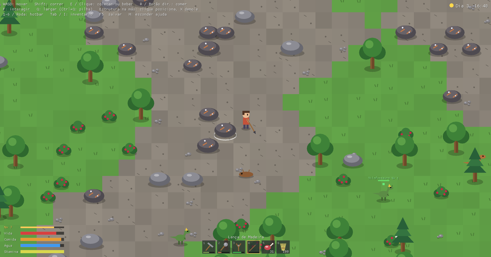

# Island

> ⚠️ **Projeto experimental.** Island é um experimento pessoal de desenvolvimento de jogos em Rust, feito em boa parte com assistência de IA. Não é um produto acabado: a arte é provisória (desenhada com formas geométricas), o balanceamento é chute, saves podem quebrar entre versões e tudo pode mudar a qualquer momento.

Survival 2D inspirado em **ARK** com elementos de MMORPG: colete recursos, fabrique ferramentas, construa, domestique dinossauros e jogue com amigos na rede local. Visão 3/4 de cima, com o personagem virando só para a esquerda ou para a direita. Roda no desktop.

## O que já tem (v0.9)

- Ilha procedural com praia, água rasa e água funda
- Coleta de madeira, palha, pedra, sílex e frutinhas
- Inventário com hotbar, pilhas e ferramentas com durabilidade
- Crafting com fila e tempo: ferramentas, fogueira, bancada, baú, fundação, parede e porta
- Construção em grid, baú de armazenamento e fogueira que ilumina a noite
- Ciclo dia/noite
- Fauna: dodôs e trilobitas passivos, dilofossauros e raptores agressivos; combate e carcaças com carne e couro
- Fogueira que cozinha carne
- Domesticação: derrube dinos com clava ou estilingue, alimente-os desacordados e monte num raptor com sela
- **Criaturas voadoras**: pteranodonte (o mais rápido) e argentavis (carrega mais peso), montáveis com sela; voe sobre a ilha e o mar
- Peso de carga dos dinos: carregado demais, o dino fica lento e não decola
- **Tribos**: acampamentos de NPCs pelo mapa; recrute moradores, dê ferramentas e armas e mande seguir, ficar, defender ou coletar e guardar no baú; domesticados lutam junto
- **Bioma de deserto** no oeste: golem de pedra disfarçado de rocha, canguru (montado, pula), louva-deus e o verme da morte, que anda debaixo da areia
- **Mar**: jangada para navegar e fauna marinha domesticável e montável (megalodonte, ictiossauro, mosassauro e kraken)
- **Bioma de pântano** no leste: beelzebufo (montado, pula), sarcosuchus (montável, nada rápido) e titanoboa, domesticáveis; lagoas com piranhas
- **Bioma de gelo** no norte da ilha: mamutes (montados, coletam madeira), smilodons (montados, tiram couro) e lobos-cinzentos em alcateia, todos domesticáveis
- Criaturas com níveis (1–30)
- Progressão: XP, nível, pontos de atributo e engramas (receitas desbloqueadas por nível)
- Montanha com metal, forja e ferramentas/espada de metal
- Vida, comida, água e stamina; morte com bolsa de itens e respawn
- **Multiplayer na rede local (LAN)**: hospede seu mundo ou entre no de um amigo; chat; servidor dedicado sem janela
- Save automático em `saves/save.json`, relativo à pasta de onde o jogo é executado

Os próximos passos estão no [ROADMAP.md](ROADMAP.md).

## Jogar

Baixe o pacote do seu sistema na página de [Releases](https://github.com/diegogit03/island/releases), extraia e execute `island` (ou `island.exe`).

- **macOS:** o binário não é assinado. Na primeira vez, clique com o botão direito no arquivo e escolha *Abrir*, ou rode `xattr -d com.apple.quarantine island`.
- **Linux:** requer OpenGL, X11 e ALSA, presentes na maioria das distros com interface gráfica.

### Controles

| Tecla | Ação |
|---|---|
| WASD / setas | Mover |
| Shift | Correr |
| E / clique esquerdo | Coletar, atacar (estilingue: mira no cursor); na beira da água, beber; montado: morder (mamute: derrubar árvores; smilodon: tirar couro de carcaças) |
| R / clique direito | Comer o item selecionado; com a jangada na mão, pô-la na água |
| Clique (estrutura na mão) | Posicionar estrutura |
| X | Demolir a estrutura sob o cursor |
| 1–6 / roda do mouse | Selecionar slot da hotbar |
| Tab / I | Inventário, personagem (atributos) e crafting/engramas |
| Q / Ctrl+Q | Largar 1 item / a pilha |
| F | Interagir: pegar itens, abrir porta/baú/fogueira, usar bancada, abrir dino (alimentar/comandar); montado: desmontar |
| Espaço | Montado: voador decola/pousa; beelzebufo e canguru pulam |
| F5 | Salvar |
| Z / C / B | Apito para a tribo por perto: seguir / ficar / defender |
| V | Apito: tribo ataca o bicho sob o mouse |
| H | Mostrar/esconder ajuda |
| Enter | Chat |
| Esc | Fechar painel / pausa (voltar ao menu) |

## Jogar com amigos (LAN)

1. Quem vai hospedar abre o jogo e clica em **Hospedar na LAN**: é o mesmo mundo do "Um jogador", agora aberto para a rede.
2. Os amigos (na mesma rede) abrem o jogo: o servidor aparece em **Jogos na rede local**. Se não aparecer, digitem o IP do host (mostrado no rodapé do menu dele) e cliquem em **Entrar**.
3. Cada jogador é reconhecido pelo nome: quem sair e voltar com o mesmo nome continua de onde parou.

Quando o host sai, a partida acaba para todos (o mundo é salvo no computador do host).

- **Firewall:** na primeira vez que hospedar, o Windows pergunta se o Island pode usar a rede: permita em *redes privadas*. As portas são **7777/TCP** (jogo) e **7778/UDP** (descoberta na LAN).
- **Servidor dedicado** (um PC só para o mundo, sem janela): `island --server`. Opções: `--port 7777`, `--save caminho/do/mundo.json`, `--name "Nome do servidor"`. O registro fica num `.log` ao lado do save; para encerrar, feche o processo (ele salva a cada 60 s e quando o último jogador sai).

## Rodar a partir do código

Requer [Rust](https://rustup.rs) estável.

```bash
cargo run
```

No Linux, instale antes: `libasound2-dev libx11-dev libxi-dev libgl1-mesa-dev`.

Comandos de desenvolvimento, arquitetura e convenções estão no [AGENTS.md](AGENTS.md).

## Releases

Ao publicar uma release no GitHub, o workflow [`release.yml`](.github/workflows/release.yml) compila o jogo para Windows (x64), Linux (x64) e macOS (Apple Silicon) e anexa os pacotes na própria release. O [`ci.yml`](.github/workflows/ci.yml) roda formatação, clippy e testes a cada push e pull request.
